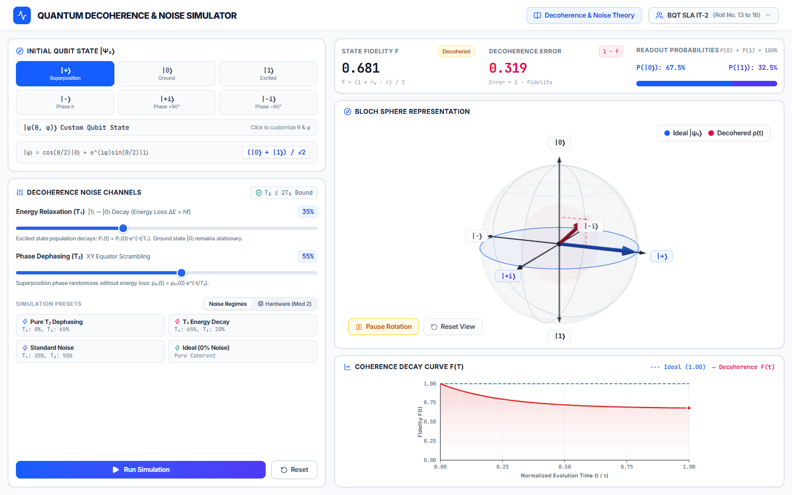
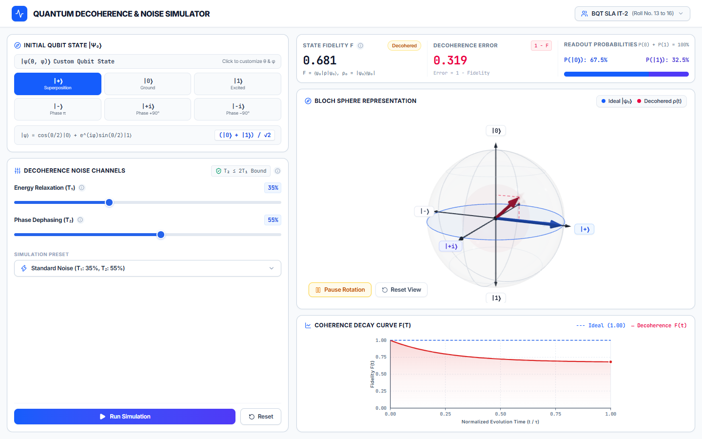
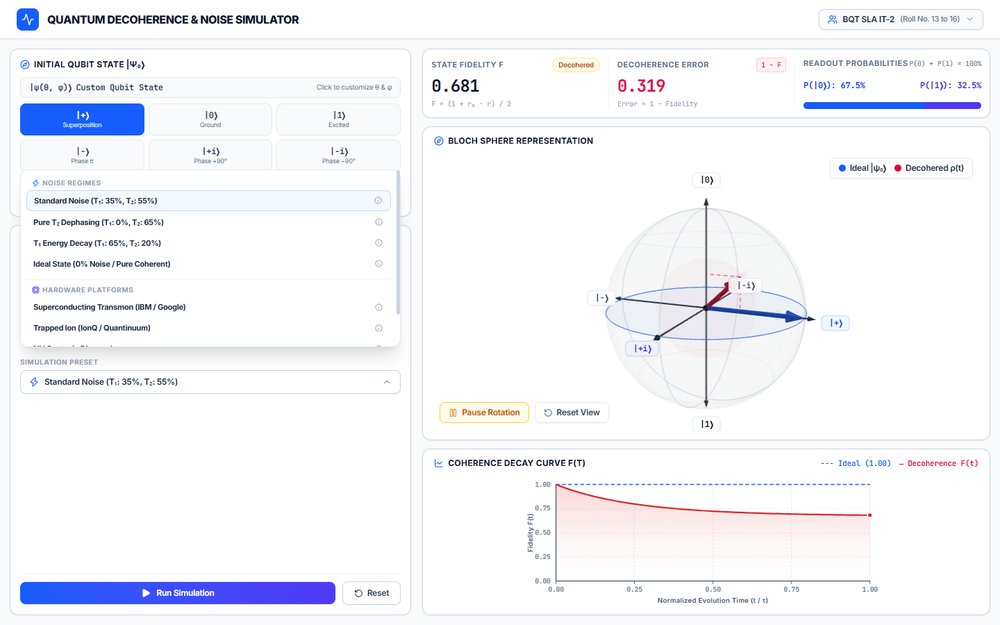

<div align="center">

# ⚛️ Quantum Decoherence 3D Simulator

### Real-Time 3D Bloch Sphere & Quantum State Visualizer

[](https://quantum-decoherence-simulator-jwalsaraiya.vercel.app/)
[](https://threejs.org/)
[](https://react.dev/)
[](https://www.typescriptlang.org/)
[](https://www.framer.com/motion/)

<p align="center">
  <b>Explore quantum mechanics in three dimensions.</b><br />
  A GPU-accelerated simulation modeling quantum superposition, phase damping, and thermal decoherence on the Bloch sphere.
</p>

<p align="center">
  🔗 <b>Live 3D Simulation:</b> <a href="https://quantum-decoherence-simulator-jwalsaraiya.vercel.app/"><b>quantum-decoherence-simulator-jwalsaraiya.vercel.app</b></a>
</p>

<p align="center">
  
</p>

</div>

---

## 🔬 The Physics Behind the Simulation

In open quantum systems, interaction with an external thermal reservoir causes a pure quantum state to lose phase coherence over time—a fundamental phenomenon known as **Quantum Decoherence**.

This engine visualizes a two-level qubit system described by the density matrix:

$$\rho = \frac{1}{2} \begin{pmatrix} 1 + z & x - iy \\ x + iy & 1 - z \end{pmatrix}$$

Where:
* **The Bloch Vector** $\vec{r} = (x, y, z)$ represents the exact expectation values $(\langle\sigma_x\rangle, \langle\sigma_y\rangle, \langle\sigma_z\rangle)$.
* **Pure States** lie strictly on the surface of the unit sphere ($|\vec{r}| = 1$).
* **Mixed States** undergo state contraction towards the interior of the sphere ($|\vec{r}| < 1$) as quantum information entropy increases.

---

## 🌟 Interactive Features

* 🌐 **Full 3D Orbit Controls**: Rotate, pan, and zoom around the Bloch sphere coordinate axes with smooth inertial damping.
* 🎛️ **Decoherence Controls**: Dynamically modulate relaxation timescales ($T_1$) and pure dephasing timescales ($T_2$).
* 🎯 **State Presets**: Instant one-click projection into computational basis states ($|0\rangle$, $|1\rangle$), equal superposition states ($|+\rangle$, $|-\rangle$), and the maximally mixed state.
* 📊 **Real-Time Telemetry**: Live readout of state purity ($\text{Tr}(\rho^2)$), Von Neumann entropy, and bloch vector coordinates.
* ⚡ **GPU Accelerated**: Built on top of **Three.js** with customized WebGL shaders for fluid 60fps rendering.

---

## 📸 Simulation Previews

<div align="center">
  
  
</div>

---

## 🛠️ Tech Stack & Architecture

```
src/
├── components/          # 3D canvas viewport, coordinate grids, and UI controllers
├── physics/             # Matrix algebra, Lindblad master equation solvers, and state rotators
├── hooks/               # Three.js animation loops and state subscriptions
└── styles/              # Dark tarmac aesthetic and HUD styling
```

* **Core Engine**: Three.js WebGL rendering pipeline
* **State Management**: Reactive Zustand / React Context with typed physics parameters
* **Interface**: Tailwind CSS with Framer Motion spring physics

---

## 🚀 Quickstart

### Installation

```bash
# 1. Clone repository
git clone https://github.com/jwalsaraiya/quantum-decoherence-simulator.git

# 2. Enter folder
cd quantum-decoherence-simulator

# 3. Install packages
npm install

# 4. Launch simulation
npm run dev
```

Open `http://localhost:5173` in any modern WebGL2-compatible browser, or explore the live deployment at [quantum-decoherence-simulator-jwalsaraiya.vercel.app](https://quantum-decoherence-simulator-jwalsaraiya.vercel.app/).

---

## 👨‍💻 Author

**Jwal Saraiya**  
*Information Technology @ Shah & Anchor Kutchhi Engineering College (SAKEC), Chembur, Mumbai*  
Building tactile 3D simulations, autonomous AI systems, and modern web applications.

* **LinkedIn**: [@jwal-saraiya](https://in.linkedin.com/in/jwal-saraiya-8203ab39b)
* **GitHub**: [@jwalsaraiya](https://github.com/jwalsaraiya)
* **Instagram**: [@jwalsaraiya](https://instagram.com/jwalsaraiya)